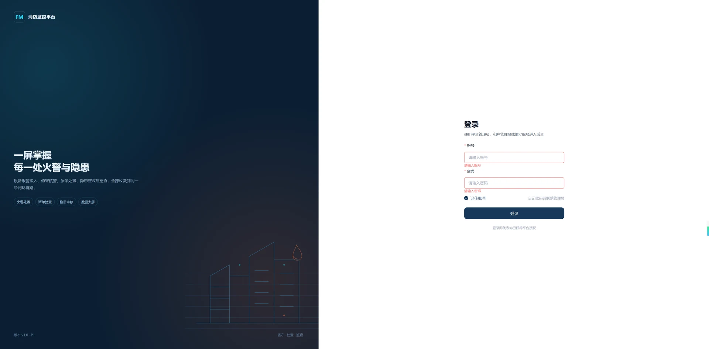
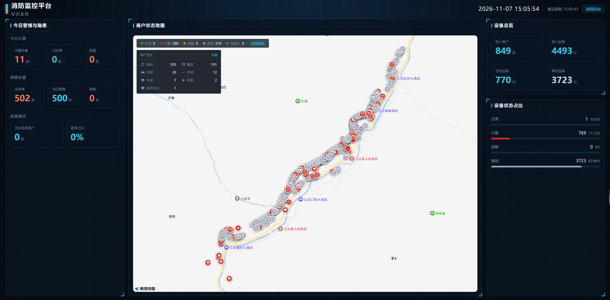
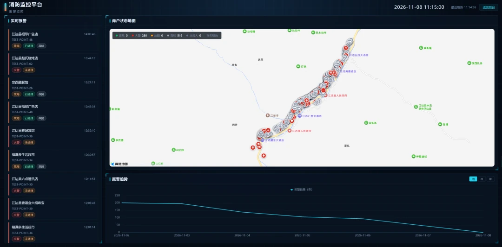
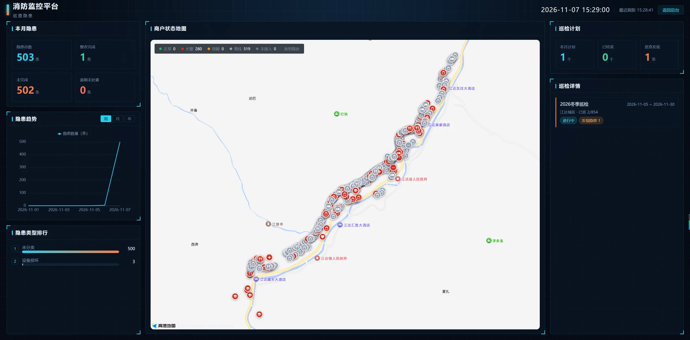
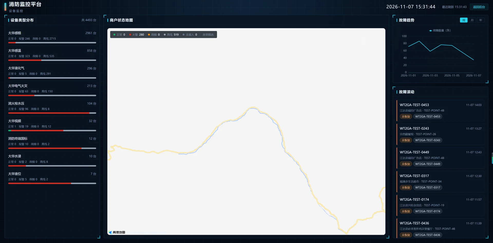
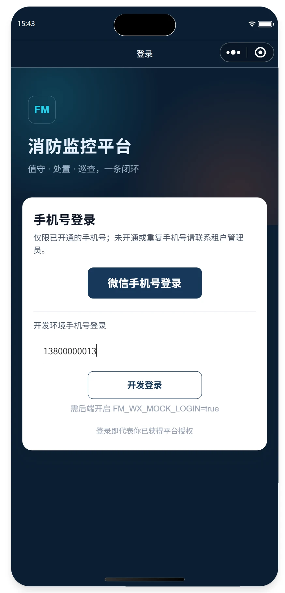
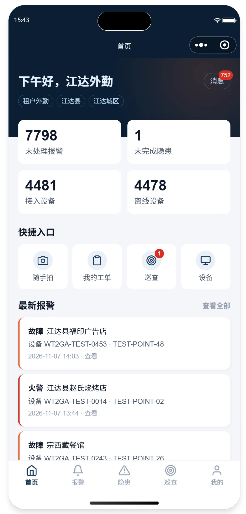
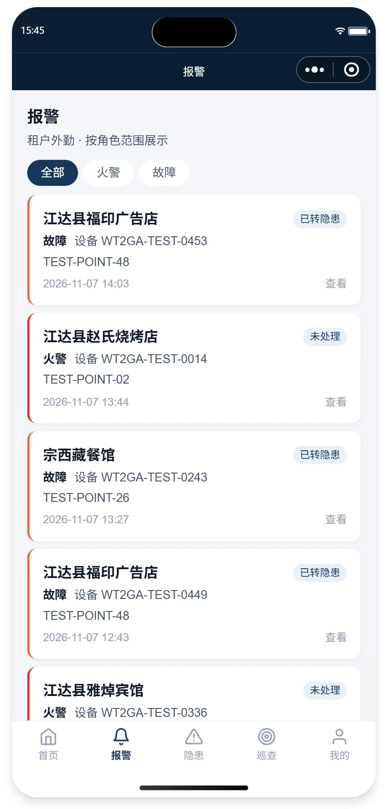
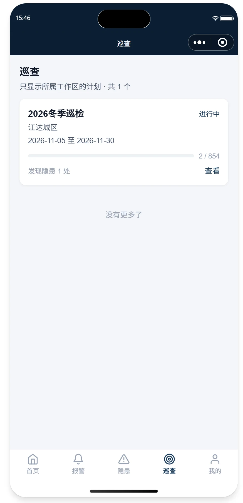
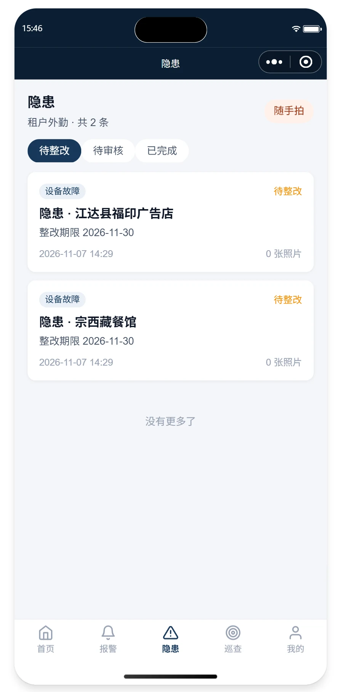

# 消防监控平台

> 面向运营中心（租户）与商户的消防物联网监控平台，把前端探测器上报的火警、故障接入值守处置流程，支持后台核警派单、小程序上报跟踪与数据大屏查看。

## 项目简介

平台按运营中心（租户）与商户两级组织数据。平台管理员维护平台级资源，租户管理员、值守、外勤在后台处理报警、工单、隐患与巡查，商户通过微信小程序查看报警、上报随手拍隐患、跟踪处置进度。服务端按 `tenant_id` 隔离数据，商户的数据范围强制收窄到本商户，角色与数据范围见「权限模型」。

设备侧由独立采集器 `fm-dh-wt2ga` 接收 CTWing 推送，经 RabbitMQ 汇入业务后端 `fm-api`，采集器不写业务库。后端把上行报文转成报警记录，后续走核警（含电话核警）、派单、工单、故障定时转隐患的处置流程，报警与隐患各留一条处置时间线。管理后台 `web-admin` 承载后台页面与四张数据大屏，移动端是 `web-miniapp` 微信小程序；图片存 MinIO，通知覆盖站内信、微信订阅消息、短信与七陌外呼。

### 核心功能

- [x] 设备接入：CTWing 上行报文、实时快照、下行指令与 ACK、设备导入导出、商户楼宇平面图布点
- [x] 报警处置：报警收口、商户处置、值守复核、派单、工单、故障定时转隐患
- [x] 隐患与巡查：随手拍上报、指派、整改、审核，按工作区编排的巡查计划
- [x] 档案与统计：水/电电子档案、统计分析、安全报告、四张数据大屏
- [x] 权限与通知：多租户角色/菜单/工作区隔离，站内信、微信订阅消息、短信、电话外呼
- [ ] 其余 8 个采集器接入：当前只完成 `fm-dh-wt2ga`，见「进度」

## 技术栈

| 层 | 选型 |
| --- | --- |
| 语言 | Java 8 |
| 框架 | Spring Boot 2.7.18 |
| 持久层 | MyBatis-Plus 3.5.3.2 |
| 数据库 | MySQL 8 |
| 缓存 | Redis 6.2 |
| 消息 | RabbitMQ 3.8 |
| 认证 | Sa-Token 1.37 |
| 前端 | Vue 3 + TypeScript + Vite 5 + Element Plus（web-admin） |
| 小程序 | 微信原生小程序 + TypeScript + Vant Weapp（web-miniapp） |

## 界面预览

截图取自当前实现：桌面端为管理后台与四张数据大屏，移动端为微信小程序。截图统一为 WebP，桌面图保持原始宽度（多数为 1920）。

### 管理后台与数据大屏

**登录页**



**综合监控**



**报警监控**



**巡查隐患**



**设备监控**



### 微信小程序

点击图片可查看原图。

| 登录 | 首页 | 报警 | 巡查 | 隐患 |
| :---: | :---: | :---: | :---: | :---: |
| <a href="assets/miniapp-login.webp"></a> | <a href="assets/miniapp-home.webp"></a> | <a href="assets/miniapp-alarm.webp"></a> | <a href="assets/miniapp-inspection.webp"></a> | <a href="assets/miniapp-danger.webp"></a> |

## 工程结构

```text
fire-monitoring/                 仓库根（聚合构建入口）
├── fm-parent/                   纯 BOM：版本管理（无 modules）
├── fm-common/                   公共依赖：统一返回、异常、常量、工具
├── fm-api/                      业务单体：system/device/alarm/danger/inspection/workorder/notify/stat
├── fm-dh-wt2ga/                 采集器：DH-HY-WT2GA 感温探测器（CTWing 推送 → MQ，不写库）
├── web-admin/                   前端应用：管理后台（Vue 3 + Vite + Element Plus）
├── web-miniapp/                 小程序（微信原生 + TypeScript + Vant Weapp）
├── assets/                      README 界面截图（WebP）
├── deploy/                      部署与种子数据
└── scripts/                     构建与启动脚本
```

构建入口为根目录 `pom.xml`（聚合 `fm-parent` / `fm-common` / `fm-api` / `fm-dh-wt2ga`）。

## 快速启动

前提：MySQL / Redis / RabbitMQ 已启动（测试环境固定为 `192.168.1.20`，见 `deploy/docker-compose.yml`）。

```bash
# 1. 中间件（已有数据卷时需手动补执行 deploy\mysql\init\V1__init.sql）
docker compose -f deploy/docker-compose.yml up -d

# 2. 后端（当前新模型库为 fm_p1）
set MYSQL_DATABASE=fm_p1
scripts\build-jdk8.bat
java -jar fm-api/target/fm-api-1.0.0-SNAPSHOT.jar

# 3. 前端（首次需先 pnpm install）
cd web-admin
npx --yes pnpm@8.15.9 install
npx --yes pnpm@8.15.9 dev            # 后台 http://localhost:5174

# 4. 小程序（微信原生）
cd web-miniapp
npm install
# 微信开发者工具导入 web-miniapp 根目录，工具内“构建 npm”后预览
```

配置项均带开发默认值，可用环境变量覆盖：

| 变量 | 默认值 |
| --- | --- |
| `MYSQL_HOST` / `MYSQL_PORT` / `MYSQL_DATABASE` | `192.168.1.20` / `3306` / `fm_p1` |
| `MYSQL_USERNAME` / `MYSQL_PASSWORD` | `root` / `123456` |
| `REDIS_HOST` / `REDIS_PORT` / `REDIS_PASSWORD` | `192.168.1.20` / `6379` / `123456` |
| `RABBITMQ_HOST` / `RABBITMQ_USERNAME` / `RABBITMQ_PASSWORD` | `192.168.1.20` / `admin` / `123456` |
| `SERVER_PORT` | `8080` |
| `WX_MA_APP_ID` / `WX_MA_SECRET` | 空；未配置时微信登录返回 503 |
| `WX_MA_ALARM_TEMPLATE_ID` / `WX_MA_SUBSCRIBE_STATE` | 空 / `developer`；订阅模板未配置时自动跳过 |
| `FM_CALL_MOCK` | `false`；为 `true` 时不调用七陌，外呼直接返回模拟成功并写通话记录 |
| `FM_CALLBACK_TOKEN` | 默认 `fm-dev-callback`；外呼回调必须携带同名令牌（查询参数 `token` 或请求头 `X-Callback-Token`），生产必须注入随机值覆盖并同步修改第三方回调 URL |
| `MINIO_ENDPOINT` / `MINIO_ACCESS_KEY` / `MINIO_SECRET_KEY` | `http://192.168.1.20:9000` / `minioadmin` / `minioadmin` |
| `MINIO_BUCKET` / `MINIO_PUBLIC_URL` | `fm-files` / 空（默认 endpoint/bucket） |

## 测试

单元测试不依赖中间件，JDK 8 下执行：

```bash
set JAVA_HOME=C:\Java\jdk1.8.0_431
mvn -B test -pl fm-api -am
```

覆盖：MQ 上行消息分流与幂等、设备实时快照入库、设备在线状态计算。

## 小程序 API（`/api/mp`）

> 下列路径均相对 `/api/mp`，按各 Controller 的 `@RequestMapping` + 方法映射整理；**接口以 Knife4j `/doc.html` 为准**（在线文档由注解生成并随代码更新，本文仅作速查）。

- 认证（`/api/mp/auth`）：`POST /auth/phone-login`、`POST /auth/wx-login`、`POST /auth/logout`、`POST /auth/switch-merchant`、`GET /auth/info`；仅 `TENANT` / `MERCHANT` 账号可登录，免登录入口只有 `phone-login` / `wx-login`；后端未提供 `/auth/login`、`/auth/bind-wx`。
- 上传：`POST /upload/image`（multipart 字段 `file`，最大 5MB），返回 MinIO 完整访问 URL。
- 报警（`/api/mp/alarm`）：`GET /alarm/page`、`GET /alarm/{id}`、`GET /alarm/{id}/timeline`、`POST /alarm/{id}/merchant-handle`；运营人员另可 `POST /alarm/{id}/verify`、`POST /alarm/{id}/dispatch`。
- 设备（`/api/mp/device`）：`GET /device/page`、`GET /device/{id}`、`GET /device/merchant-options`、`GET /device/dict/danger-type`。
- 隐患（`/api/mp/danger`）：`GET /danger/page`、`GET /danger/{id}`、`GET /danger/{id}/timeline`、`POST /danger`（随手拍上报）、`GET /danger/assignee-options`；运营人员另可 `POST /danger/{id}/assign`、`POST /danger/{id}/deal`、`POST /danger/{id}/audit`。
- 巡查（`/api/mp/inspection`）：`GET /inspection/plan/page`、`GET /inspection/plan/{id}`、`GET /inspection/plan/{id}/merchants`、`GET /inspection/plan/{id}/merchant/page`、`POST /inspection/result`，仅运营人员可用。
- 工单（`/api/mp/workorder`）：`GET /workorder/page`、`GET /workorder/{id}`、`POST /workorder/{id}/accept`、`POST /workorder/{id}/finish`，仅运营人员可用。
- 消息与订阅（`/api/mp/notification`）：`GET /notification/page`、`GET /notification/unread-count`、`PUT /notification/{id}/read`、`GET /notification/subscribe-config`、`POST /notification/subscribe`。
- 首页与概览：`GET /home/summary`、`GET /stat/overview`。

商户账号的数据范围由服务端强制收窄到本商户，详情接口另有归属校验；运营人员按所属租户范围访问。微信登录需配置 `WX_MA_APP_ID` / `WX_MA_SECRET`，账号由管理员写入 `wx_app_openid` 后可用微信登录，或直接用手机号白名单登录（`POST /auth/phone-login`）；图片统一存 MinIO（启动时自动建 bucket 并设公共只读，不可达时启动失败）。生产建议使用独立对象存储、私有 bucket + CDN/临时签名。

订阅消息：在微信公众平台创建一次订阅模板，字段需为 `thing1`（报警位置）、`time2`（报警时间）、`thing3`（报警类型）、`thing4`（商户），把模板 ID 配到 `WX_MA_ALARM_TEMPLATE_ID`；生产把 `WX_MA_SUBSCRIBE_STATE` 改为 `formal`。用户在小程序“我的”页点“报警通知”授权，授权一次只可发送一条，发送后需重新授权。

## 权限模型

- 后台：平台管理员、租户管理员、租户值守；小程序：租户管理员、租户外勤、商户。
- 平台管理员对租户业务只读，租户业务写接口返回 403；平台级资源（运营中心、字典、平台基线菜单、平台角色）可写。
- 租户管理员维护本租户用户、角色、菜单、商户、设备、巡检与隐患审核；值守负责核警、电话核警、派单；外勤限所属工作区；商户限本店。
- 菜单按 `tenant_id` 隔离，新租户创建时复制平台基线一次；手机号在 `sys_user` 全局唯一，作为小程序白名单键。
- 派单先选工作区，再从工作区成员中选择外勤。

## 进度

| 阶段 | 状态 |
| --- | --- |
| P0 设计基线与骨架 | 完成：文档、6 张原型、旧前端归档、根 pom/脚本清理 |
| P1 账户/权限/基础数据 | 完成：后台 3 角色 + 小程序 3 角色登录、菜单/按钮权限、租户菜单隔离、手机号白名单 |
| P2 报警/核警/派单/工单/跟踪 | 完成：报警收口、商户处置、值守复核、派单+工单、故障转隐患（人工+定时）、时间线 |
| P3 隐患/巡检/随手拍 | 完成：隐患来源/指派/整改/审核、巡检计划按工作区、随手拍、站内消息 |
| P4 商户/设备/档案/大屏 | 完成：商户/楼宇/平面图布点、设备导入导出/详情、水/电档案、4 个大屏 |
| P5 统计/报告/收尾 | 进行中：6 个统计页、外呼配置、核警/工单照片、安全报告“建设中”已完成；剩余视觉/真机验收、V2 迁移与一键启动固化 |
| 设备采集 | 进行中：`fm-dh-wt2ga` 已完成上行链路与真实报文回放入库验证；其余 8 个采集器未开工 |
